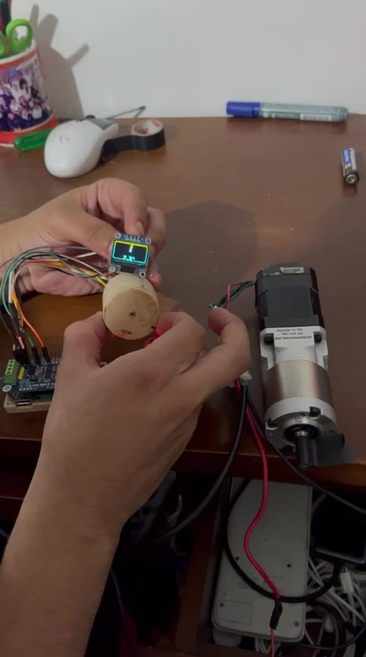

# Steer-by-Wire Portfolio

Prototipo de banco para estudiar una direccion steer-by-wire con Raspberry Pi
Zero 2 W, sensor magnetico AS5600, pantalla OLED y un actuador UIM conectado
directamente por CAN.

> Estado: prototipo funcional de banco. No esta validado para uso en un
> vehiculo ni reemplaza una arquitectura de seguridad automotriz.

## Demostracion actual

La cadena completa validada el 5 de agosto de 2026 es:

```text
AS5600 -> I2C -> Raspberry Pi -> SocketCAN -> MCP2515 HAT -> UIM342 -> UIM4247CM
                    |
                    +-> OLED SSD1306
```

El volante de prueba actualiza la flecha y los grados en la OLED. La misma
lectura se convierte en una posicion absoluta para el motor. La velocidad del
actuador aumenta cuando el volante se mueve mas rapido.

[](docs/evidence/2026-08-05/bench-follow-as5600-uim342.mp4)

[Ver video de la prueba de seguimiento](docs/evidence/2026-08-05/bench-follow-as5600-uim342.mp4)

## Estado validado

- AS5600 y OLED compartiendo el bus I2C.
- HAT WVS-14882 con MCP2515 y oscilador de 12 MHz.
- Interfaz `can0` por SocketCAN a `500 kbit/s`.
- Comunicacion directa con UIM342, nodo CAN `13`.
- Movimiento relativo de banco con posicion y velocidad verificadas.
- Seguimiento continuo AS5600 -> posicion absoluta del motor.
- Parada ante fallo CAN, estado inseguro del motor o lecturas sostenidamente
  incoherentes del sensor.
- Restauracion de aceleracion y desaceleracion del motor al terminar.

## Calibrar cero del sensor

Con el volante quieto en la posicion que debe ser `0°`, ejecutar:

```bash
cd ~/Documentos/steer-by-wire
source .venv/bin/activate
python3 tools/steer_by_wire_follow_runtime.py calibrate-zero --no-oled
```

El cero queda guardado en `.sbw_sensor_zero.json` y se carga automaticamente en
`monitor` y `follow`, incluso despues de apagar y prender la Raspberry Pi.

## Prueba de sensor sin OLED

Esta prueba no envia ordenes al motor:

```bash
cd ~/Documentos/steer-by-wire
source .venv/bin/activate
python3 tools/steer_by_wire_follow_runtime.py monitor --no-oled --terminal-hz 5 --duration 10
```

Debe imprimir en la terminal lineas como `AS5600 angle=... raw=...`. El angulo
se muestra como valor relativo firmado alrededor del cero guardado; por ejemplo,
una lectura cercana a `358°` se muestra como `-2°`. Por defecto, cualquier valor
entre `-2°` y `+2°` se muestra como `0°`; ese filtro se puede ajustar con
`--zero-deadband`.

## Seguimiento completo de banco

Antes de ejecutarlo, el eje debe estar libre y debe existir acceso inmediato
al corte de la fuente de 24 V.

```bash
cd ~/Documentos/steer-by-wire
sudo .venv/bin/python tools/steer_by_wire_follow_runtime.py follow \
  --continuous \
  --unlimited-angle \
  --min-speed 400 \
  --max-speed 160000 \
  --command-deadband 40 \
  --command-hz 25 \
  --no-oled \
  --terminal-hz 5 \
  --status-hz 10 \
  --max-sensor-step 60 \
  --max-sensor-outliers 5 \
  --max-tracking-error 80000 \
  --tracking-error-time 2.0 \
  --acceleration-ms 100 \
  --deceleration-ms 100 \
  --allow-invalid-magnet \
  --confirm BANCO_LIBRE
```

`Ctrl+C` solicita una parada controlada. La fuente de 24 V debe apagarse antes
de manipular el motor o el cableado CAN.

## Limitaciones observadas

- El soporte actual permite que el iman se incline o se aleje del AS5600.
- El AS5600 reporta campo debil en parte de la prueba; por eso el modo usado en
  el video incluye `--allow-invalid-magnet`.
- Un paso del AS5600 equivale aproximadamente a `39 pulsos` de salida con la
  reduccion actual. El umbral de envio es `40 pulsos`, de modo que un cambio
  minimo puede aparecer en la OLED antes de producir movimiento visible.
- La Raspberry Pi ejecuta Linux y no ofrece garantias de tiempo real duro.
- Aun no existe un sensor independiente en la salida mecanica de direccion.

La prioridad siguiente no es aumentar mas los limites de software. Primero se
debe rigidizar y centrar el conjunto iman-sensor; despues se mediran latencia,
error de seguimiento y respuesta a baja velocidad.

## Software

- `tools/oled_compass.py`: interfaz grafica de la OLED.
- `tools/hat_can_probe.py`: diagnostico independiente del HAT y `can0`.
- `tools/steer_by_wire_can_runtime.py`: diagnostico y movimientos CAN
  limitados de banco.
- `tools/steer_by_wire_follow_runtime.py`: seguimiento AS5600/OLED/CAN con
  protecciones y modo continuo.
- `tools/steer_by_wire_runtime.py`: ruta heredada RS232/UIM2513 conservada como
  respaldo.

## Pruebas de software

```bash
python3 tests/test_steer_by_wire_can_runtime.py
python3 tests/test_steer_by_wire_follow_runtime.py
```

## Estructura

- `docs/`: arquitectura, decisiones, manuales y evidencia.
- `hardware/`: CAD, piezas y ensambles mecanicos.
- `tests/`: pruebas del protocolo CAN y del seguimiento.
- `thesis-latex/`: estructura academica del proyecto.
- `tools/`: runtimes y utilidades de banco.

## Avance mecanico actual

La primera version del soporte motor-caja de direccion ya esta incorporada al
repositorio:

- pieza nativa `SBW-001_support-motor_v01.SLDPRT`;
- ensamble `support_v01.SLDASM`;
- modelo de referencia del motorreductor `EG17-G50.SLDPRT`;
- estudio estatico inicial de SolidWorks Simulation;
- registro mecanico inicial en [evidencia 2026-08-17](docs/evidence/2026-08-17/README.md).


## Documentacion principal

- [Indice de documentacion](docs/README.md)
- [Seguimiento directo por CAN](docs/direct-can-follow-runtime.md)
- [Evaluacion del HAT WVS-14882](docs/hat-wvs-14882-evaluacion.md)
- [Manual AS5600 y Raspberry Pi](docs/manual-as5600-rpi-zero-2w.md)
- [Arquitectura heredada UIM2513](docs/arquitectura-uim2513-rs232-can.md)
- [Roadmap](docs/roadmap.md)
- [Evidencia del 5 de agosto de 2026](docs/evidence/2026-08-05/README.md)
