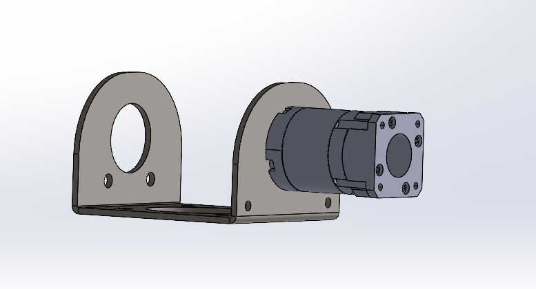

# Evidencia 2026-08-17

## Version 1 del soporte motor-caja de direccion

Esta carpeta registra la primera iteracion del soporte mecanico que une el
motorreductor con la caja de direccion del banco steer-by-wire.

## Contenido

- `support-motor-v01-preview.png`: vista preliminar del modelo CAD.
- registro documental de la version 1 del soporte.

## Archivos CAD relacionados

- `hardware/cad/parts/SBW-001_support-motor_v01.SLDPRT`
- `hardware/cad/assemblies/support-motor-steering-box/support_v01.SLDASM`
- `hardware/cad/vendor/stepper/EG17-G50.SLDPRT`

## Analisis asociado

El primer estudio estatico de SolidWorks Simulation se conserva junto a la
pieza en `hardware/cad/parts/` para mantener la relacion directa entre
geometria y resultados.

Los archivos CAD y del estudio ya quedaron versionados en el repositorio.
